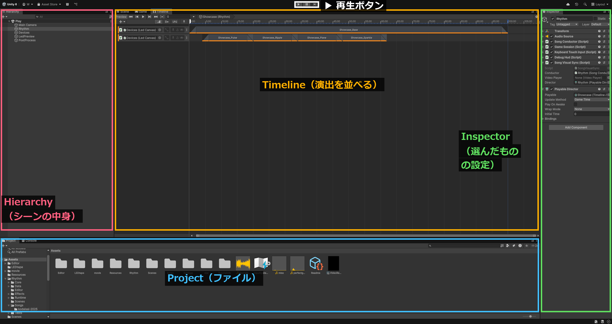
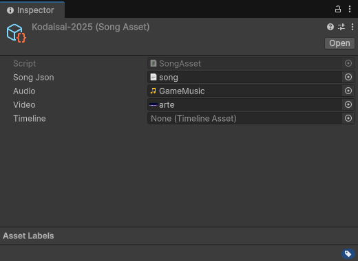
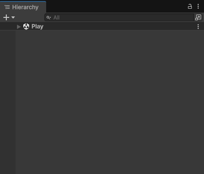
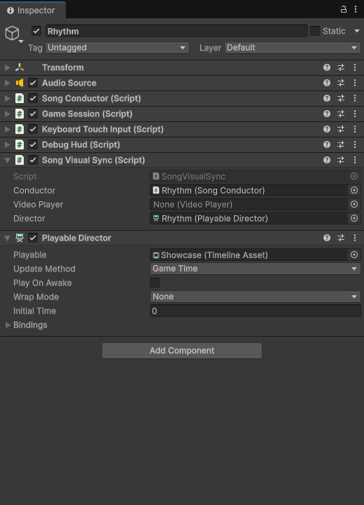
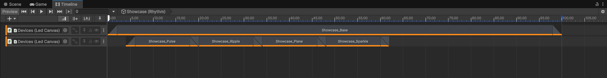
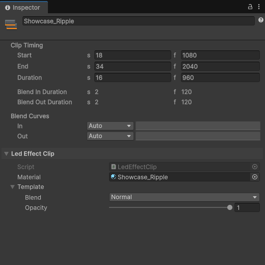
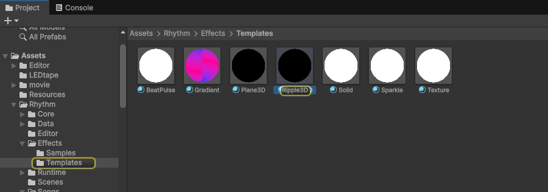
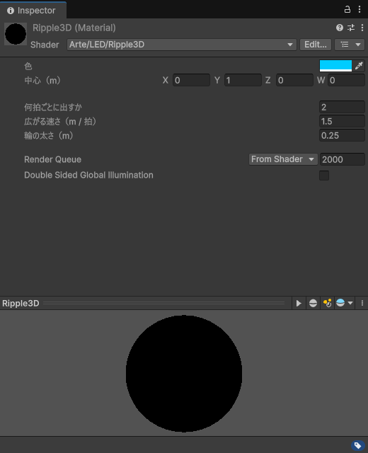
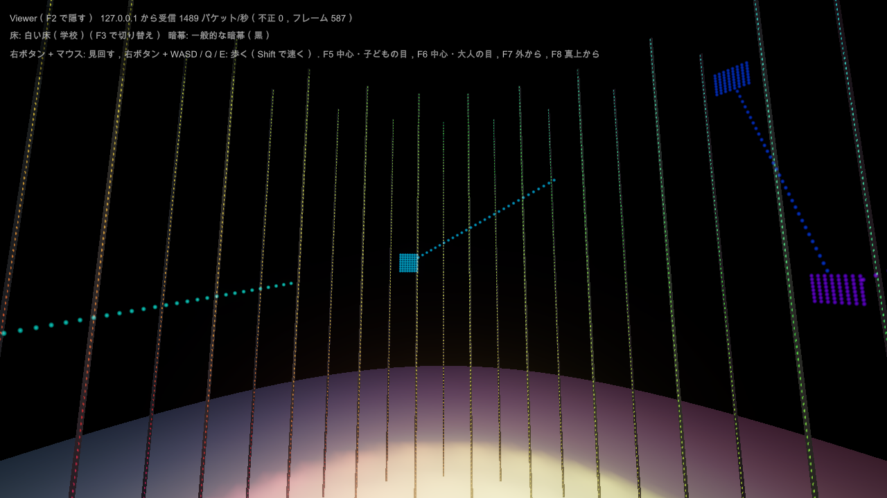
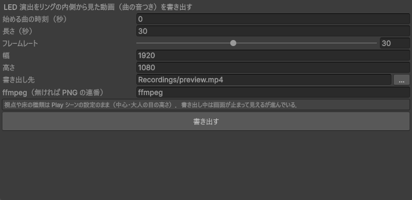

# LED 演出の作り方

コードを書かずに，Unity の Timeline に「演出のクリップ」を並べて LED の演出を作る．
作った演出は，リングの内側から見たシミュレーション（暗幕の部屋）で確かめ，動画に書き出して見せられる．
Unity を初めて使う人向けに，画面の写真を付けてある．

## しくみ（最初に読む）

- 演出用 LED は **キャンバス** という小さな絵（横 90 × 縦 120 ピクセル）に描いたものが，そのまま光る．
  1 ピクセルが LED 1 個．横の 1 列がテープ 1 本（リングを囲む柱），縦が高さ（下が 0）．
- キャンバスの列はリングを順番に回っていない（内側・外側・真ん中の輪が交互に並ぶ）．
  リングを回る動きや，部屋の中の位置で決まる動き（球が広がる，板が横切る）は，
  テンプレートの「一周」「3D」のもの（LED の本当の位置を使う）を選ぶ．
- 演出は Timeline の **LED 演出トラック** にクリップとして置く．
  - クリップ 1 個 = 演出 1 つ（マテリアル 1 個）
  - クリップの端を引くとフェードイン・アウト．同じトラックで重ねるとクロスフェード
  - トラックを増やすと上に重なる（Timeline で上のトラックから順に重ねる）
- 時間は曲の時刻．テンポ（song.json の tempo）を入れておくと，「拍」で動く演出が曲に合う．
  テンポが無いと 120BPM とみなす．
- 実機の LED は暗めに設定してある（明るさ 50/255）ので，画面で見るより段階が粗い．
  暗い色の細かい違いは LED では出にくい．

## 0. Unity の画面



| 場所 | 何をするところか |
| --- | --- |
| Hierarchy（左上） | 今開いているシーンの中身の一覧．ここで選んだものの設定が Inspector に出る |
| Timeline（真ん中） | 演出を時間に沿って並べる．上のタブで Scene / Game（再生した画面）/ Timeline を切り替える |
| Inspector（右） | 選んだもの（シーンの中のもの，ファイル，クリップ）の設定 |
| Project（下） | プロジェクトのファイル．フォルダをたどってマテリアルや曲を探す |
| 再生ボタン（上の真ん中） | 押すと Play モード（ゲームとして動く）．もう一度押すと止まる |

Timeline が見当たらないときは，上のメニューの Window → Sequencing → Timeline で開く．

## 1. 準備

1. Project で `Assets/Rhythm/Scenes/Play` をダブルクリックして開く．
2. 自分のフォルダを作る: Project の `Assets/Rhythm/Effects` を右クリック → Create → Folder で `<自分の名前>` を作る．
3. 曲用の Timeline を作る: 自分のフォルダで右クリック → Create → Timeline．
   曲の SongAsset（`Assets/Rhythm/Songs/kodaisai-2025/kodaisai-2025`）を選び，Inspector の `Timeline` に作った Timeline をドラッグして入れる．
   入れないうちは見本（`Assets/Rhythm/Effects/Samples/Showcase`）が流れる．

   

## 2. 演出を置く

1. Hierarchy の `Rhythm` を選ぶ．

   

2. Inspector の下の方の Playable Director の `Playable` に，自分の Timeline を入れる（Timeline ウィンドウに表示される）．

   

3. Timeline ウィンドウの左上の「+」→ **LED Effect Track** でトラックを足す（見本では 2 本: 下に敷く土台と，上に重ねる演出）．
   トラックの右の丸（バインド先）は空でよい．
4. トラックの上で右クリック → **Add LED Effect Clip** でクリップを置く．左右の端を引くと長さ，クリップ同士を重ねるとクロスフェードになる．

   

5. クリップを選ぶと Inspector にクリップの設定が出る．
   - `Material`: 演出のマテリアル（次の 6. で用意する）
   - `Template` の中の `Blend`（重ね方）: Normal（上書き）/ Add（光を足す．きらめきや点滅に）/ Multiply（下の色を暗くする）/ Lighten（明るい方）
   - `Template` の中の `Opacity`（不透明度）: 0〜1
   - `Blend In / Out Duration`: フェードイン・アウトの長さ（秒）

   

6. マテリアルは `Assets/Rhythm/Effects/Templates` のテンプレートを **自分のフォルダに複製して** 使う
   （テンプレートを選んで Ctrl+D で複製し，自分のフォルダへドラッグ．テンプレートそのものは直さない）．

   

7. 複製したマテリアルを選ぶと，Inspector に演出の設定が日本語で出る．色をクリックすると色を選べる．

   

### テンプレート

| テンプレート | 何をするか | 主な設定 |
| --- | --- | --- |
| Solid（単色） | 全部を 1 色 | 色 |
| Gradient（グラデーション） | 2 色の間を高さ方向か一周方向に．流せる | 色 1・色 2，向き，流す速さ（1 拍で進む割合），往復 |
| BeatPulse（拍で光る） | 決めた拍ごとにぱっと光って消える | 色，何拍ごと，消える速さ |
| Ripple3D（波紋） | 部屋の 1 点から光の球が広がる | 色，中心（m），何拍ごと，広がる速さ（m/拍），輪の太さ |
| Plane3D（面が通り抜ける） | 光る板が部屋を横切る | 色，進む向き，何拍ごと，出発・到着の位置，厚さ |
| Sparkle（きらめき） | ランダムな LED がちらちら | 色，光る割合，1 拍で入れ替わる回数 |
| Texture（画像・動画を貼る） | 画像をキャンバスに貼るか一周に巻き付ける | 画像，貼り方，色，横に流す速さ |

3D の位置は m（メートル）で，リングの中心が原点，上が y．LED は高さ 0〜2m，リングの半径は 1.2〜1.7m．

## 3. 確かめる

1. 再生ボタンを押し，上のタブで Game を選んでから，キーボードの **Enter** で曲が始まる．
   リングの内側から見たシミュレーションが映る（暗幕の部屋．床も LED の光で照らされる）．

   

2. 操作（Game の画面をクリックしてから）:

| キー | 内容 |
| --- | --- |
| Enter / Space | 最初から再生 / 一時停止・再開 |
| ← → | 5 秒戻る / 進む |
| 右ボタン + マウス，右ボタン + WASD / Q / E | 見回す，歩く（Shift で速く） |
| F5 / F6 / F7 / F8 | 中心・子どもの目 / 中心・大人の目 / 外から / 真上から |
| F2 | 実機の接続状態の表示（「色の曲線」で LED の見え方を切り替え） |

再生中にマテリアルの値を変えると，その場で見た目が変わる（マテリアルはファイルなので，再生を止めても変えた値が残る）．
Timeline のクリップの位置は，再生を止めてから動かす．
実機がつながっていれば，同じ演出が実機の LED にも出る．

## 4. 動画に書き出す

上のメニューの Window → Arte Rhythm → **Preview Export** を開き，始める時刻・長さ・大きさを決めて「書き出す」．
Play シーンが開いて 1 フレームずつ撮り，終わると止まる（その間は触らない）．
曲の音つきの mp4 ができる（既定は `3d-rhythmgame/Recordings/preview.mp4`）．
PC が遅くてもコマ落ちしない．ffmpeg が無い PC では PNG の連番になる（ffmpeg を入れると mp4 になる）．



コマンドで書き出す場合（ビルドした Play.exe）:

```text
Play.exe -record out.mp4 -record-from 30 -record-length 20 -record-fps 30 -record-size 1920x1080 -view child -floor school-white
```

## 5. 自分でシェーダーを書く（上級）

テンプレートの `.shader`（`Assets/Rhythm/Runtime/Render/Shaders/Templates/`）を複製して書き換える．
`#include "../ArteLed.cginc"` で次の値と道具が使える．返す色はリニア（マテリアルの Color はそのまま使える）．

| 名前 | 中身 |
| --- | --- |
| `_ArteTime` | 曲の時刻（秒） |
| `_ArteBeat`，`_ArteBar` | 拍，小節（小数） |
| `_ArteCanvasSize` | (列数, LED 数, 1/列数, 1/LED 数) |
| `_ArteClipTime`，`_ArteClipProgress` | クリップが始まってからの秒，クリップの中の位置（0〜1） |
| `ArtePosition(uv)` | その LED の 3D 位置（m）．w は付いていれば 1（外したストリップは 0） |
| `ArteAngle01(p)` | 中心から見た角度（一周で 0〜1） |
| `ArteBeatPhase(every)` | every 拍ごとに 0〜1 を繰り返す |
| `ArteHue(h)`，`ArteHash(p)`，`ArteScreenToLinear(c)` | 色相 → 色，乱数，画面の色 → リニア |

普通の重ね方では，返す色の a（アルファ）が「そこを塗る強さ」になる（光らない所は a = 0 にすると下が見える）．

## スクリーンショットを撮り直す

Unity のバージョンや画面が変わったら，Unity を閉じてから次で撮り直せる（`docs/authoring/images/` に保存して終了する．撮影中は触らない）．

```text
Unity.exe -projectPath 3d-rhythmgame -executeMethod Arte.Rhythm.Editor.DocScreenshots.Run
```

全体の画面（00-editor.png）の枠と名前は，撮ったあとに ffmpeg で描いている．
